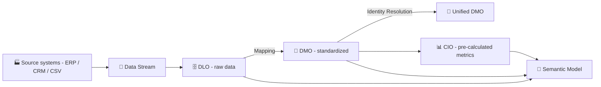
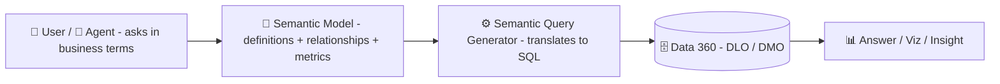

# 📘 What Is Tableau Semantics and Why It Matters in the AI Era

> Understand **Tableau Semantics**, the semantic layer on Salesforce Data 360, from the basics of **DLOs and DMOs** to building your first Semantic Model

🇹🇭 [ภาษาไทย](README.md) · 🇺🇸 **English**

> [!IMPORTANT]
> **Last updated: 9 October 2026.** Tableau Semantics and Tableau Next change quickly. Menu names and some features (especially Beta ones) may differ by release. Check the latest references before use.

> [!NOTE]
> **⚖️ Disclaimer**
>
> *This document is a personal compilation intended for knowledge-sharing purposes only. It is not official documentation from the product owner and shall not be used as a commercial reference. Please verify all information against the product owner's official website before use.*

---

## 🧭 Contents

| | Topic |
|:---:|---|
| ⚡ | [One-Minute Summary](#-one-minute-summary) |
| 1️⃣ | [What Is Tableau Semantics](#1️⃣-what-is-tableau-semantics) |
| 2️⃣ | [The Basics: Data Stream, DLO, DMO, and CIO](#2️⃣-the-basics-data-stream-dlo-dmo-and-cio) |
| 3️⃣ | [Why You Need It](#3️⃣-why-you-need-it) |
| 4️⃣ | [Where It Came From](#4️⃣-where-it-came-from) |
| 5️⃣ | [Benefits](#5️⃣-benefits) |
| 6️⃣ | [Pros and Cons](#6️⃣-pros-and-cons) |
| 7️⃣ | [Prerequisites](#7️⃣-prerequisites) |
| 8️⃣ | [How It Works](#8️⃣-how-it-works) |
| 9️⃣ | [Building a Semantic Model](#9️⃣-building-a-semantic-model) |
| 🔟 | [Compared with a Published Data Source, and Best Practices](#-compared-with-a-published-data-source-and-best-practices) |
| 🚀 | [Next Steps](#-next-steps) |
| 📖 | [Glossary](#-glossary) |
| 🎓 | [Learning Resources](#-learning-resources) |
| 📚 | [References](#-references) |

---

## ⚡ One-Minute Summary

| Question | Short answer |
|---|---|
| 📘 **What is it** | A middle layer that turns raw data into business language that people and AI understand the same way |
| 🏠 **Where it lives** | On Salesforce **Data 360** (formerly Data Cloud) |
| 🎯 **What it solves** | Mismatched numbers across teams, and AI answering wrongly because it lacks business definitions |
| 🧱 **Core unit** | The **Semantic Model**: tables, relationships, calculations, and metrics in one place |
| 🗂️ **Data it uses** | **DLOs** (ingested data) and **DMOs** (standardized data) in Data 360 |
| ⚖️ **Trade-offs** | Requires Data 360, adds cost, and ties you to the Salesforce ecosystem |
| 🔑 **Key to success** | Definitions the organization **agrees on** matter more than the tool |

---

## 1️⃣ What Is Tableau Semantics

Tableau Semantics is Salesforce's **semantic layer** on **Data 360**. It translates raw tables into business language that both people and AI understand the same way.

> [!TIP]
> 🗣️ **Think of it as a company interpreter:** the database says `SUM(amt_net) WHERE status = 'C'`, an executive says "net sales". The interpreter knows these are the same thing and always answers with the same formula.

Its core unit is the **Semantic Model**, a "container" of business definitions for one use case.

| Component | Meaning | Example |
|---|---|---|
| 🗂️ **Data Objects** | Tables in Data 360: DLOs, DMOs, and CIOs *(see section 2️⃣)* | Orders, Customers |
| 🔗 **Relationships** | Which fields connect the tables | Orders ↔ Customers on Customer ID |
| 🧮 **Calculated Fields** | Extra formulas (dimensions / measurements) | Profit Ratio |
| 📏 **Metrics** | Time-aware KPIs with a shared definition | Monthly Sales |
| 🏷️ **Business Metadata** | Friendly names, descriptions, synonyms | `amt_net` → "Net Sales" |

> [!NOTE]
> Semantic Models are native Salesforce metadata, so they can be reused in Tableau Next, Agentforce, Tableau Cloud / Desktop, and through APIs.

📎 References: [Tableau Semantics (Product Page)](https://www.tableau.com/products/tableau-semantics) · [Tableau Semantics Concepts (Salesforce Developers)](https://developer.salesforce.com/docs/data/semantic-layer/guide/tableau-semantics-concepts.html)

---

## 2️⃣ The Basics: Data Stream, DLO, DMO, and CIO

Before building a Semantic Model, it helps to know how data moves through Data 360.

### 📌 Definitions

| Term | Full name | Plain-language definition |
|---|---|---|
| 🔌 **Data Stream** | Data Stream | **The "pipe"**: connection details for a source, such as the origin (S3, Google BigQuery, etc.), fields brought in, primary key, and refresh frequency |
| 🗄️ **DLO** | Data Lake Object | **The "raw storage room"** where data ingested into Data 360 (or referenced from an external system such as Snowflake) is stored, still in the source's structure |
| 🧩 **DMO** | Data Model Object | **"Standardized data"**: a shared structure for data from one or more DLOs, for example every system using the same "Email" field |
| 👤 **Unified DMO** | Unified Data Model Object | A DMO that **merges records of the same person from multiple systems** through identity resolution rules |
| 📊 **CIO** | Calculated Insight Object | **"Pre-calculated metrics"** such as Customer Lifetime Value or customer satisfaction (CSAT) |

### 🍳 A Restaurant Kitchen Analogy

| Step | In the kitchen | In Data 360 |
|:---:|---|---|
| 1 | 🚚 Supplier delivery truck | 🔌 **Data Stream** |
| 2 | 📦 Storeroom of ingredients as delivered | 🗄️ **DLO** |
| 3 | 🔪 Ingredients washed, cut, and prepped to a standard | 🧩 **DMO** |
| 4 | 🧂 Sauces and stocks made in advance | 📊 **CIO** |
| 5 | 📖 Recipes and menu the whole kitchen follows | 📘 **Semantic Model** |
| 6 | 🍽️ The dish served to the customer | 📊 Dashboard / AI agent answer |

### 🔄 How Data Flows

### ⚖️ DLO vs DMO

| | 🗄️ DLO | 🧩 DMO |
|---|---|---|
| **Structure** | Follows the source system | Follows a shared standard model (Customer 360 Data Model) |
| **Field names** | As in the source, e.g. `cust_email`, `e_mail` | One shared name, e.g. `Email` |
| **Comes from** | A Data Stream or an uploaded file | Mapping from one or more DLOs |
| **Used for** | Storing and preparing data | Combining data from many systems for shared use |

### 🏢 Example: Demo Company

| Step | What happens |
|:---:|---|
| 1 | The POS and e-commerce systems send sales data through separate **Data Streams** |
| 2 | Each system's data lands in its own **DLO** with different field names (`cust_email` vs `e_mail`) |
| 3 | The data team **maps** both DLOs to a "Sales Order" **DMO** that uses a single `Email` field |
| 4 | **Identity resolution** merges the same customer from both systems into a **Unified DMO** |
| 5 | A **Semantic Model** uses the DMO to define "net sales" so every team and AI agent uses the same definition |

> [!TIP]
> When you upload a **CSV** file to a Tableau Next workspace, it is stored in Data 360 as a **DLO** and can be used in a Semantic Model right away.

📎 References: [Understanding Salesforce and Data Cloud Terms (Tableau Help)](https://help.tableau.com/current/tableau-next/en-us/tableau_next_sf_datacloud_terms.htm) · [Object Model in Data 360 (Salesforce Developers)](https://developer.salesforce.com/docs/data/data-cloud-dev/guide/dc-object-model.html)

---

## 3️⃣ Why You Need It

The classic problem is **numbers that don't match**.

> [!NOTE]
> 🏢 **Example:** At **Demo Company**, Sales counts revenue with VAT, Finance counts it after discounts, and Marketing counts online orders only. Every meeting starts with thirty minutes of arguing over whose number is right.

AI makes this worse. An agent has no business context, so without a shared definition it guesses, and **answers wrongly with confidence**.

> [!IMPORTANT]
> The semantic layer is **the "brain" of a data agent**. Agent accuracy is capped by the quality of the Semantic Model behind it.

📎 Reference: [What is Tableau Semantics? (Tableau Blog)](https://www.tableau.com/blog/what-is-tableau-semantics)

---

## 4️⃣ Where It Came From

| Era | Development |
|---|---|
| 📼 **1990s** | Early BI tools add a middle layer mapping columns to business terms (the "Universe" idea) |
| 💻 **2010s** | Self-service BI spreads; every dashboard has its own formulas, so tools like LookML and metrics layers emerge |
| 📊 **Classic Tableau** | Published Data Sources and the Data Model (Relationships) act as a data-source-level semantic layer |
| 🚀 **2024** | Salesforce announces its agentic analytics platform (Tableau Einstein, later renamed **Tableau Next**) with Tableau Semantics |
| ✅ **2025** | Tableau Semantics becomes generally available, and on **14 October 2025** Data Cloud is renamed **Data 360** |
| 🤖 **2026** | AI features such as automatic model creation arrive (some still Beta) |

> [!TIP]
> **The key shift:** business definitions move out of individual workbooks and data sources up to the **platform level**, shared by every app and agent.

📎 References: [What is Tableau Semantics? (Tableau Blog)](https://www.tableau.com/blog/what-is-tableau-semantics) · [Understanding Salesforce and Data Cloud Terms (Tableau Help)](https://help.tableau.com/current/tableau-next/en-us/tableau_next_sf_datacloud_terms.htm) · [What you need to know about Tableau Next in 2026 (Hex)](https://hex.tech/blog/tableau-next/)

---

## 5️⃣ Benefits

| | Benefit | Details |
|:---:|---|---|
| 🎯 | **Single Source of Truth** | Define a metric once, use it everywhere |
| 🤖 | **More Accurate AI** | Agentforce and Tableau Agent understand business questions because they have context |
| ⚡ | **Faster Modeling** | AI suggests relationships and drafts formulas from natural language |
| 🛡️ | **Governed Self-service** | Business users explore freely within controlled definitions |
| ♻️ | **Keep What You Have** | Import existing Published Data Sources, and connect from Tableau Cloud, Server, and Desktop |

📎 References: [Tableau Semantics (Salesforce)](https://www.salesforce.com/analytics/tableau-semantics/) · [Tableau Semantics (Product Page)](https://www.tableau.com/products/tableau-semantics)

---

## 6️⃣ Pros and Cons

| ✅ Pros | ⚠️ Cons / Limits |
|---|---|
| Shared definitions end number disputes | **Requires Data 360**; not available standalone |
| Designed for AI agents from the start | Adds cost: comes with Tableau+ and consumes Data 360 credits |
| Reusable across the Salesforce ecosystem | Ties you to Salesforce (vendor lock-in) |
| AI assistance reduces manual modeling | Large databases with many tables take real effort to model |
| UI resembles Relationships in Tableau Desktop | Several new features are still Beta and change quickly |
| Governance and security inherited from the platform | Needs clear definition owners, or model quality suffers |

> [!WARNING]
> **Common misconception:** "a semantic layer fixes our data". It **does not clean dirty data**. If the source is wrong, even a good definition returns a wrong answer.

📎 References: [Semantic Modelling in Tableau Next: The Pros and Cons (The Data School)](https://thedataschool.co.uk/sharon-orazulike/tableau-next-3/) · [Tableau Cloud Pricing](https://www.tableau.com/pricing/cloud)

---

## 7️⃣ Prerequisites

### 🖥️ Technical

| # | Requirement |
|:---:|---|
| 1 | A Salesforce org with **Data 360** enabled |
| 2 | A **Tableau+** license (includes Tableau Next and Tableau Semantics) or a Data 360 license |
| 3 | Data ingested or federated into Data 360 as **DLOs / DMOs** *(see section 2️⃣)* |
| 4 | User permissions to create and edit Semantic Models |

### 👥 People and Process *(just as important)*

| # | Requirement |
|:---:|---|
| 1 | A list of core metrics with agreed definitions |
| 2 | A named owner for each definition (for example, Finance owns "Revenue") |
| 3 | One clear, small starting use case |

📎 References: [Tableau Semantics (Product Page)](https://www.tableau.com/products/tableau-semantics) · [Tableau Cloud Pricing](https://www.tableau.com/pricing/cloud)

---

## 8️⃣ How It Works

The heart of the system is the **Semantic Query Generator**, which takes a business question and translates it into SQL using the Semantic Model.

| Step | What happens |
|:---:|---|
| 1 | A user or agent asks, for example, "net sales by region this month" |
| 2 | "Net sales" is matched to the metric defined in the Semantic Model |
| 3 | The Semantic Query Generator builds SQL from the shared relationships and formulas |
| 4 | The query runs in Data 360 |
| 5 | Results return as a visualization, a metric, or an agent's answer |

📎 Reference: [Tableau Semantics Concepts (Salesforce Developers)](https://developer.salesforce.com/docs/data/semantic-layer/guide/tableau-semantics-concepts.html)

---

## 9️⃣ Building a Semantic Model

General flow in Tableau Next *(menu names may vary by release)*

| Step | Action |
|:---:|---|
| 1 | **Prepare data:** bring it into Data 360 and confirm the DLOs / DMOs are ready |
| 2 | **Open a workspace:** in Tableau Next, add the data objects you need |
| 3 | **Create a new Semantic Model:** with a name and description that reflect the use case |
| 4 | **Add data objects:** to the model canvas |
| 5 | **Define relationships:** pick join fields or accept AI suggestions, and click Apply each time |
| 6 | **Rename and describe fields:** in business language; hide what isn't needed |
| 7 | **Create calculated fields:** describe them in natural language and let AI draft the formula |
| 8 | **Create metrics:** set the measure, time dimension, and drill-down dimensions |
| 9 | **Test:** pull fields from several tables and check the numbers |
| 10 | **Use it:** build visualizations and dashboards or expose the model to agents, then share |

> [!TIP]
> If you already have Tableau **Published Data Sources**, import one as a starting point. It saves time and keeps formulas your team already trusts.

### 🧩 Techniques Worth Knowing

| Technique | What it's for |
|---|---|
| 🧩 **Logical View** | Joins / unions inside the model; the result behaves like a single table you can relate to other objects |
| 🔗 **Relationship** | Connects tables directly on the Semantic Model; no Logical View needed |
| 🌱 **Extend Model** | Builds a new model on top of a core model while staying linked to the original; good for teams extending a shared model |
| 🧪 **Test Model** | Pulls fields to see how the data behaves before building visualizations |

📎 References: [Semantic Models in Tableau Next Quick Look (Trailhead)](https://trailhead.salesforce.com/content/learn/modules/semantic-models-in-tableau-next-quick-look/get-to-know-semantic-models) · [Tableau Next: Building a Semantic Model (The Data School)](https://www.thedataschool.co.uk/rosh-khan/tableau-next-building-a-semantic-model) · [Semantic Models and Logical Views (The Data School)](https://thedataschool.co.uk/olivia-grace-yuki-millar/semantic-models-in-tableau-next-2)

---

## 🔟 Compared with a Published Data Source, and Best Practices

| Topic | 📊 Published Data Source | 📘 Tableau Semantics |
|---|---|---|
| **Lives in** | Tableau Cloud / Server | Data 360 (Salesforce Platform) |
| **Used by** | Tableau | Tableau Next, Agentforce, Tableau Cloud / Desktop, APIs |
| **Designed for** | Analysts building vizzes | People and AI agents |
| **Shared metrics** | Through Tableau Pulse | Part of the model |

### ✅ Best Practices

| | Practice |
|:---:|---|
| 🏷️ | Name fields the way users actually speak, and always add descriptions, because AI reads them |
| 🎯 | One model per use case; avoid a single model for everything |
| 🔁 | Review definitions with business owners on a regular cadence |

> [!WARNING]
> When connecting from Tableau Desktop or Tableau Cloud through the **Tableau Semantics connector**, some Tableau functionality is unavailable because it is controlled by the Semantic Model. Test with a real workbook before planning a migration.

📎 References: [Connect to Semantic Models (Trailhead)](https://trailhead.salesforce.com/content/learn/modules/data-management-across-tableau-products/connect-to-semantic-models) · [Understanding Salesforce and Data Cloud Terms (Tableau Help)](https://help.tableau.com/current/tableau-next/en-us/tableau_next_sf_datacloud_terms.htm)

---

## 🚀 Next Steps

| Step | Action |
|:---:|---|
| 1 | Collect 5–10 key metrics and agree on their definitions with business owners |
| 2 | Check whether your current licensing covers Tableau+ / Data 360 |
| 3 | Pick one pilot use case (for example, Sales Performance) |
| 4 | Check whether Data 360 already has the DLOs / DMOs you need |
| 5 | Build a first Semantic Model, or import an existing Published Data Source |
| 6 | Test questions through an agent and refine field descriptions until answers are accurate |
| 7 | Expand to the next use case and set up governance |

---

## 📖 Glossary

| Term | Meaning |
|---|---|
| **Semantic Layer** | A middle layer that turns raw data into business language |
| **Semantic Model** | The core unit of Tableau Semantics: data, relationships, formulas, and metrics for one use case |
| **Data 360** | Salesforce's data platform (formerly Data Cloud, renamed on 14 October 2025) |
| **Data Stream** | Connection details for a source system and how often data is pulled |
| **DLO** | Data Lake Object: stores data ingested into Data 360 in the source's structure |
| **DMO** | Data Model Object: a standardized data structure mapped from DLOs |
| **Unified DMO** | A DMO that merges records of the same person from multiple systems through identity resolution |
| **CIO** | Calculated Insight Object: a metric calculated and stored in Data 360 |
| **Identity Resolution** | Rules that match and merge records of the same person or entity from multiple sources |
| **Published Data Source (PDS)** | A data source published to Tableau Cloud / Server for many workbooks to share |
| **Tableau Next** | Tableau's agentic analytics platform on Salesforce |
| **Agentforce** | Salesforce's AI agent platform |

📎 References: [Understanding Salesforce and Data Cloud Terms (Tableau Help)](https://help.tableau.com/current/tableau-next/en-us/tableau_next_sf_datacloud_terms.htm) · [Object Model in Data 360 (Salesforce Developers)](https://developer.salesforce.com/docs/data/data-cloud-dev/guide/dc-object-model.html)

---

## 🎓 Learning Resources

| Type | Resource | Best for |
|---|---|---|
| 🎥 YouTube | [Tableau Tim: Tableau Next Playlist](https://youtu.be/Rp5lw1EYmPM) | Step-by-step demos |
| 🎥 YouTube | Official Tableau and Salesforce Developers channels | New features and conference sessions |
| 🏔️ Trailhead | [Semantic Models in Tableau Next Quick Look](https://trailhead.salesforce.com/content/learn/modules/semantic-models-in-tableau-next-quick-look/get-to-know-semantic-models) | Beginners |
| 🏔️ Trailhead | [Connect to Semantic Models](https://trailhead.salesforce.com/content/learn/modules/data-management-across-tableau-products/connect-to-semantic-models) | Tableau Desktop / Cloud users |
| 🎬 Course | [The Information Lab: Getting Started with Tableau Next](https://www.theinformationlab.co.uk/services/training/on-demand/getting-started-with-tableau-next/creating-a-semantic-model-65c0/) | Multi-part on-demand course |
| 📝 Blog | [The Data School: Building a Semantic Model](https://www.thedataschool.co.uk/rosh-khan/tableau-next-building-a-semantic-model) | Hands-on with screenshots |
| 📝 Blog | [The Data School: Semantic Models and Logical Views](https://thedataschool.co.uk/olivia-grace-yuki-millar/semantic-models-in-tableau-next-2) | Logical View |
| 📝 Blog | [The Data School: Join, Union, Relationship](https://thedataschool.co.uk/tomo-mensendiek/tableau-next-4/) | Combining tables |

---

## 📚 References

Checked on **9 October 2026**

| Source | Covers |
|---|---|
| [Tableau Semantics (Product Page)](https://www.tableau.com/products/tableau-semantics) | Product overview |
| [What is Tableau Semantics? (Tableau Blog)](https://www.tableau.com/blog/what-is-tableau-semantics) | Concept and importance |
| [Tableau Semantics Concepts (Salesforce Developers)](https://developer.salesforce.com/docs/data/semantic-layer/guide/tableau-semantics-concepts.html) | Components and how it works |
| [Understanding Salesforce and Data Cloud Terms (Tableau Help)](https://help.tableau.com/current/tableau-next/en-us/tableau_next_sf_datacloud_terms.htm) | Definitions of Data Stream, DLO, DMO, CIO, and the Data 360 rename |
| [Object Model in Data 360 (Salesforce Developers)](https://developer.salesforce.com/docs/data/data-cloud-dev/guide/dc-object-model.html) | Object structure and DLO-to-DMO mapping |
| [Tableau Semantics (Salesforce)](https://www.salesforce.com/analytics/tableau-semantics/) | Benefits and use cases |
| [Tableau Cloud Pricing](https://www.tableau.com/pricing/cloud) | Editions that include Tableau Semantics |
| [Semantic Modelling in Tableau Next: The Pros and Cons (The Data School)](https://thedataschool.co.uk/sharon-orazulike/tableau-next-3/) | Pros and limitations |
| [What you need to know about Tableau Next in 2026 (Hex)](https://hex.tech/blog/tableau-next/) | Evolution of Tableau Next |

---

[⬆️ Back to top](#-what-is-tableau-semantics-and-why-it-matters-in-the-ai-era) · 🇹🇭 [ภาษาไทย](README.md)

> [!NOTE]
> **⚖️ Disclaimer**
>
> *This document is a personal compilation intended for knowledge-sharing purposes only. It is not official documentation from the product owner and shall not be used as a commercial reference. Please verify all information against the product owner's official website before use.*

**Created by The Narit Lab**
