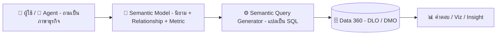

# 📘 Tableau Semantics คืออะไร และทำไมองค์กรยุค AI ต้องมี

> ทำความเข้าใจ **Tableau Semantics** ชั้นความหมายของข้อมูล (Semantic Layer) บน Salesforce Data 360 ว่าคืออะไร ทำงานอย่างไร ข้อดี ข้อเสีย และเริ่มต้นสร้าง Semantic Model อย่างไร

🇹🇭 **ภาษาไทย** · 🇺🇸 [English version](README.en.md)

> [!IMPORTANT]
> **อัปเดตล่าสุด: 9 ตุลาคม 2026** ฟีเจอร์ของ Tableau Semantics และ Tableau Next มีการเปลี่ยนแปลงเร็ว ชื่อเมนูและบางฟีเจอร์ (โดยเฉพาะที่เป็น Beta) อาจต่างไปตาม Release ควรตรวจสอบกับแหล่งอ้างอิงล่าสุดก่อนใช้งาน

> [!NOTE]
> **⚖️ ข้อจำกัดความรับผิดชอบ (Disclaimer)**
>
> เอกสารนี้จัดทำขึ้นจากการรวบรวมข้อมูลโดยส่วนตัวของผู้เขียน เพื่อวัตถุประสงค์ในการแบ่งปันความรู้เท่านั้น มิใช่เอกสารทางการของเจ้าของผลิตภัณฑ์ และไม่สามารถใช้เป็นเอกสารอ้างอิงทางการค้าได้ หากต้องการนำข้อมูลไปใช้อ้างอิง กรุณาตรวจสอบข้อมูลล่าสุดจากเว็บไซต์ทางการของเจ้าของผลิตภัณฑ์อีกครั้ง
>
> *This document is a personal compilation intended for knowledge-sharing purposes only. It is not official documentation from the product owner and shall not be used as a commercial reference. Please verify all information against the product owner's official website before use.*

---

## 🧭 สารบัญ

| | หัวข้อ |
|:---:|---|
| 1️⃣ | [Tableau Semantics คืออะไร](#1️⃣-tableau-semantics-คืออะไร) |
| 2️⃣ | [ทำไมต้องมี](#2️⃣-ทำไมต้องมี) |
| 3️⃣ | [ที่มา](#3️⃣-ที่มา) |
| 4️⃣ | [ประโยชน์](#4️⃣-ประโยชน์) |
| 5️⃣ | [ข้อดี และ ข้อเสีย](#5️⃣-ข้อดี-และ-ข้อเสีย) |
| 6️⃣ | [สิ่งที่ต้องมี](#6️⃣-สิ่งที่ต้องมี) |
| 7️⃣ | [การทำงาน](#7️⃣-การทำงาน) |
| 8️⃣ | [การสร้าง Semantic Model](#8️⃣-การสร้าง-semantic-model) |
| 9️⃣ | [สรุป](#9️⃣-สรุป) |
| 🔟 | [เพิ่มเติม: เทียบกับ Published Data Source](#-เพิ่มเติม-เทียบกับ-published-data-source) |
| 🚀 | [Next Step](#-next-step) |
| 🎓 | [แหล่งเรียนรู้เพิ่มเติม](#-แหล่งเรียนรู้เพิ่มเติม) |
| 📚 | [แหล่งอ้างอิง](#-แหล่งอ้างอิง) |

---

## 1️⃣ Tableau Semantics คืออะไร

Tableau Semantics คือ **Semantic Layer** (ชั้นความหมายของข้อมูล) ของ Salesforce ที่ฝังอยู่ใน **Data 360** (ชื่อเดิม Data Cloud) ทำหน้าที่แปล "ข้อมูลดิบในตาราง" ให้เป็น "ภาษาธุรกิจ" ที่ทั้งคนและ AI เข้าใจตรงกัน

> [!TIP]
> 🗣️ **เปรียบง่าย ๆ:** Semantic Layer คือ **ล่ามประจำองค์กร** ฐานข้อมูลพูดว่า `SUM(amt_net) WHERE status = 'C'` ส่วนผู้บริหารพูดว่า "ยอดขายสุทธิ" ล่ามคนนี้รู้ว่าสองอย่างคือเรื่องเดียวกัน และตอบทุกคนด้วยสูตรเดียวกันเสมอ

หน่วยหลักของ Tableau Semantics คือ **Semantic Model** ซึ่งเป็นเหมือนกล่องที่รวมนิยามทางธุรกิจสำหรับหนึ่ง Use Case ไว้ด้วยกัน

| องค์ประกอบ | ความหมาย | ตัวอย่าง |
|---|---|---|
| 🗂️ **Data Objects** | ตารางข้อมูลจาก Data 360 (DLO, DMO, Calculated Insights) | Orders, Customers |
| 🔗 **Relationships** | ความสัมพันธ์ระหว่างตาราง | Orders ↔ Customers ด้วย Customer ID |
| 🧮 **Calculated Fields** | Dimension และ Measurement ที่คำนวณเพิ่ม | Profit Ratio |
| 📏 **Metrics** | ตัวชี้วัดที่มีมิติเวลาและนิยามกลาง | ยอดขายรายเดือน |
| 🏷️ **Business Metadata** | ชื่อที่อ่านง่าย คำอธิบาย คำพ้อง | `amt_net` → "ยอดขายสุทธิ" |

> [!NOTE]
> Semantic Model เป็น Metadata ของ Salesforce โดยตรง จึงนำไปใช้ซ้ำได้ทั้งใน Tableau Next, Agentforce, Tableau Cloud / Desktop และผ่าน API

📎 อ้างอิง: [Tableau Semantics (Product Page)](https://www.tableau.com/products/tableau-semantics) · [Tableau Semantics Concepts (Salesforce Developers)](https://developer.salesforce.com/docs/data/semantic-layer/guide/tableau-semantics-concepts.html)

---

## 2️⃣ ทำไมต้องมี

ปัญหาคลาสสิกที่ทุกองค์กรเจอคือ **"ตัวเลขไม่ตรงกัน"**

> [!NOTE]
> 🏢 **ตัวอย่าง:** ที่ **บริษัทตัวอย่าง (Demo Company)** ฝ่ายขายนับ "ยอดขาย" รวม VAT ฝ่ายบัญชีนับหลังหักส่วนลด ฝ่ายการตลาดนับเฉพาะออเดอร์ออนไลน์ ประชุมทีไรใช้เวลาครึ่งชั่วโมงแรกเถียงกันว่าตัวเลขใครถูก

ในยุค AI ปัญหานี้หนักขึ้น เพราะ AI Agent ไม่รู้บริบทธุรกิจ ถ้าถามว่า "ยอดขายไตรมาสนี้เท่าไร" โดยไม่มีนิยามกลาง Agent จะเดาเอง และ **ตอบผิดอย่างมั่นใจ**

> [!IMPORTANT]
> Semantic Layer คือ **"สมอง" ของ AI Agent ด้านข้อมูล** Agent จะตอบได้แม่นแค่ไหน ขึ้นกับคุณภาพของ Semantic Model ที่อยู่ข้างหลัง

📎 อ้างอิง: [What is Tableau Semantics? (Tableau Blog)](https://www.tableau.com/blog/what-is-tableau-semantics)

---

## 3️⃣ ที่มา

แนวคิด Semantic Layer ไม่ใช่ของใหม่ มีพัฒนาการมายาวนาน

| ยุค | พัฒนาการ |
|---|---|
| 📼 **ยุค 1990s** | BI รุ่นแรกเริ่มมีชั้นกลางแปลชื่อคอลัมน์เป็นคำธุรกิจ (เช่น แนวคิด "Universe") |
| 💻 **ยุค 2010s** | Self-service BI เติบโต แต่ละ Dashboard มีสูตรของตัวเอง เกิดปัญหานิยามซ้ำซ้อน จึงเกิดเครื่องมืออย่าง LookML และ Metrics Layer |
| 📊 **Tableau ยุคเดิม** | ใช้ Published Data Source และ Data Model (Relationships) เป็น Semantic Layer ระดับ Data Source |
| 🚀 **ปี 2024** | Salesforce เปิดตัวแพลตฟอร์ม Agentic Analytics (Tableau Einstein ซึ่งต่อมาเปลี่ยนชื่อเป็น **Tableau Next**) พร้อม Tableau Semantics |
| ✅ **ปี 2025** | Tableau Semantics เปิดใช้งานจริง (GA) สำหรับลูกค้า Tableau+ และ Data Cloud |
| 🤖 **ปี 2026** | Data Cloud เปลี่ยนชื่อเป็น Data 360 และเพิ่มฟีเจอร์ AI เช่น การสร้าง Model อัตโนมัติ (บางตัวยังเป็น Beta) |

> [!TIP]
> **จุดต่างสำคัญ:** Tableau Semantics ยกนิยามออกจาก "ไฟล์ Workbook / Data Source" ขึ้นมาอยู่ที่ **ระดับแพลตฟอร์ม** เพื่อให้ทุกแอปและทุก Agent ใช้ร่วมกัน

📎 อ้างอิง: [What is Tableau Semantics? (Tableau Blog)](https://www.tableau.com/blog/what-is-tableau-semantics) · [What you need to know about Tableau Next in 2026 (Hex)](https://hex.tech/blog/tableau-next/)

---

## 4️⃣ ประโยชน์

| | ประโยชน์ | รายละเอียด |
|:---:|---|---|
| 🎯 | **Single Source of Truth** | นิยาม Metric ครั้งเดียว ใช้ได้ทุกที่ ตัวเลขตรงกันทั้งองค์กร |
| 🤖 | **AI ตอบแม่นขึ้น** | Agentforce และ Tableau Agent เข้าใจคำถามภาษาธุรกิจเพราะมีบริบท |
| ⚡ | **สร้างเร็วขึ้น** | AI ช่วยแนะนำ Relationship และเขียน Calculated Field จากภาษาธรรมชาติ |
| 🛡️ | **Self-service ที่ปลอดภัย** | ผู้ใช้ธุรกิจสำรวจข้อมูลเองได้ภายใต้นิยามที่ถูกกำกับดูแล |
| ♻️ | **ไม่ต้องทิ้งของเดิม** | นำเข้า Published Data Source ที่มีอยู่ได้ และเชื่อมต่อจาก Tableau Cloud, Server, Desktop กลับมาใช้ Semantic Model ได้ |

📎 อ้างอิง: [Tableau Semantics (Salesforce)](https://www.salesforce.com/analytics/tableau-semantics/) · [Tableau Semantics (Product Page)](https://www.tableau.com/products/tableau-semantics)

---

## 5️⃣ ข้อดี และ ข้อเสีย

| ✅ ข้อดี | ⚠️ ข้อเสีย / ข้อจำกัด |
|---|---|
| นิยามกลาง ลดการเถียงเรื่องตัวเลข | **ต้องมี Data 360** ใช้แยกเดี่ยวไม่ได้ |
| รองรับ AI Agent ตั้งแต่ออกแบบ | ค่าใช้จ่ายสูง มากับ Tableau+ และใช้ Data Cloud Credits |
| Reuse ได้ข้ามแอปใน Salesforce Ecosystem | ผูกกับ Ecosystem ของ Salesforce (Vendor Lock-in) |
| AI ช่วยสร้าง Model ลดงาน Manual | ฐานข้อมูลใหญ่ ตารางเยอะ การทำ Model ใช้แรงมาก |
| UI คล้าย Relationships ใน Tableau Desktop เรียนรู้ง่าย | ฟีเจอร์ใหม่หลายตัวยังเป็น Beta เปลี่ยนแปลงเร็ว |
| Governance และ Security สืบทอดจากแพลตฟอร์ม | ต้องมีเจ้าของนิยาม (Data Owner) ชัดเจน ไม่งั้น Model ก็ไม่มีคุณภาพ |

> [!WARNING]
> **ความเข้าใจผิดที่พบบ่อย:** "มี Semantic Layer แล้วข้อมูลจะดีเอง" ความจริงคือ Semantic Layer **ไม่ได้แก้ข้อมูลสกปรก** ถ้าข้อมูลต้นทางผิด นิยามที่สวยแค่ไหนก็ให้คำตอบผิด

📎 อ้างอิง: [Semantic Modelling in Tableau Next: The Pros and Cons (The Data School)](https://thedataschool.co.uk/sharon-orazulike/tableau-next-3/) · [Tableau Cloud Pricing](https://www.tableau.com/pricing/cloud)

---

## 6️⃣ สิ่งที่ต้องมี

### 🖥️ ด้านเทคนิค

| # | สิ่งที่ต้องมี |
|:---:|---|
| 1 | Salesforce Org ที่เปิดใช้ **Data 360** |
| 2 | License **Tableau+** (ซึ่งรวม Tableau Next และ Tableau Semantics) หรือ License Data 360 |
| 3 | ข้อมูลที่นำเข้าหรือ Federate เข้า Data 360 แล้ว (ในรูป DLO / DMO) |
| 4 | สิทธิ์ผู้ใช้ที่เหมาะสมสำหรับการสร้างและแก้ไข Semantic Model |

### 👥 ด้านคนและกระบวนการ *(สำคัญไม่แพ้กัน)*

| # | สิ่งที่ต้องมี |
|:---:|---|
| 1 | รายการ Metric หลักขององค์กรพร้อมนิยามที่ตกลงกันแล้ว |
| 2 | เจ้าของนิยามแต่ละตัว (เช่น ฝ่ายบัญชีเป็นเจ้าของ "รายได้") |
| 3 | Use Case ที่ชัดเจน เริ่มจากเล็ก ๆ หนึ่งเรื่อง |

📎 อ้างอิง: [Tableau Semantics (Product Page)](https://www.tableau.com/products/tableau-semantics) · [Tableau Cloud Pricing](https://www.tableau.com/pricing/cloud)

---

## 7️⃣ การทำงาน

หัวใจของระบบคือ **Semantic Query Generator** ซึ่งรับคำถามเชิงธุรกิจแล้วแปลเป็น SQL ตามนิยามใน Semantic Model

| ขั้นตอน | สิ่งที่เกิดขึ้น |
|:---:|---|
| 1 | ผู้ใช้หรือ Agent ถาม เช่น "ยอดขายสุทธิแยกตามภูมิภาคเดือนนี้" |
| 2 | ระบบจับคู่คำว่า "ยอดขายสุทธิ" กับ Metric ที่นิยามไว้ใน Semantic Model |
| 3 | Semantic Query Generator สร้าง SQL โดยใช้ Relationship และสูตรกลาง |
| 4 | Query ถูกส่งไปประมวลผลที่ Data 360 |
| 5 | ผลลัพธ์ถูกส่งกลับเป็น Visualization, Metric หรือคำตอบของ Agent |

📎 อ้างอิง: [Tableau Semantics Concepts (Salesforce Developers)](https://developer.salesforce.com/docs/data/semantic-layer/guide/tableau-semantics-concepts.html)

---

## 8️⃣ การสร้าง Semantic Model

ขั้นตอนโดยรวมใน Tableau Next *(ชื่อเมนูอาจต่างไปตาม Release)*

| ขั้นตอน | ทำอะไร |
|:---:|---|
| 1 | **เตรียมข้อมูล:** นำข้อมูลเข้า Data 360 และตรวจสอบว่า Data Object พร้อมใช้ |
| 2 | **เปิด Workspace:** ใน Tableau Next แล้วเพิ่ม Data Object ที่ต้องการ |
| 3 | **สร้าง Semantic Model ใหม่:** ตั้งชื่อและคำอธิบายให้สื่อถึง Use Case |
| 4 | **เพิ่ม Data Objects:** ลงใน Model Canvas |
| 5 | **กำหนด Relationships:** เลือก Field ที่ใช้เชื่อม หรือใช้คำแนะนำจาก AI แล้วกด Apply ทุกครั้ง |
| 6 | **ปรับชื่อและคำอธิบาย Field:** ให้เป็นภาษาธุรกิจ ซ่อน Field ที่ไม่จำเป็น |
| 7 | **สร้าง Calculated Fields:** (Dimension / Measurement) พิมพ์เป็นภาษาธรรมชาติให้ AI ช่วยร่างสูตรได้ |
| 8 | **สร้าง Metrics:** กำหนด Measure, มิติเวลา และ Dimension ที่ใช้เจาะลึก |
| 9 | **ทดสอบ:** ดึง Field จากหลายตารางมาดูผลว่า Relationship ให้ตัวเลขถูกต้อง |
| 10 | **นำไปใช้:** สร้าง Visualization, Dashboard หรือเปิดให้ Agent ใช้งาน แล้วแชร์ให้ทีม |

> [!TIP]
> ถ้ามี Tableau **Published Data Source** อยู่แล้ว ให้ลองนำเข้ามาเป็นจุดเริ่มต้นแทนการสร้างใหม่จากศูนย์ จะประหยัดเวลาและรักษาสูตรเดิมที่ทีมคุ้นเคย

### 🧩 เทคนิคที่ควรรู้เพิ่ม

| เทคนิค | ใช้ทำอะไร |
|---|---|
| 🧩 **Logical View** | ทำ Join และ Union ภายใน Model ได้ผลลัพธ์เป็นเหมือนตารางเดียวที่นำไปสร้าง Relationship ต่อได้ |
| 🔗 **Relationship** | สร้างที่ตัว Semantic Model โดยตรง ไม่ต้องใช้ Logical View |
| 🌱 **Extend Model** | สร้าง Model ใหม่ต่อยอดจาก Model เดิมโดยยังเชื่อมกับต้นฉบับ เหมาะกับการมี Model กลางแล้วให้แต่ละทีมขยายเอง |
| 🧪 **Test Model** | ดึง Field มาดูพฤติกรรมข้อมูลก่อนนำไปสร้าง Visualization |

📎 อ้างอิง: [Semantic Models in Tableau Next Quick Look (Trailhead)](https://trailhead.salesforce.com/content/learn/modules/semantic-models-in-tableau-next-quick-look/get-to-know-semantic-models) · [Tableau Next: Building a Semantic Model (The Data School)](https://www.thedataschool.co.uk/rosh-khan/tableau-next-building-a-semantic-model) · [Semantic Models and Logical Views (The Data School)](https://thedataschool.co.uk/olivia-grace-yuki-millar/semantic-models-in-tableau-next-2)

---

## 9️⃣ สรุป

| | ประเด็นสำคัญ |
|:---:|---|
| 📘 | Tableau Semantics คือ Semantic Layer ระดับแพลตฟอร์มบน Data 360 ที่แปลข้อมูลเป็นภาษาธุรกิจ |
| 🎯 | แก้ปัญหา "ตัวเลขไม่ตรงกัน" และเป็นรากฐานให้ AI Agent ตอบได้ถูกต้อง |
| 🧱 | หน่วยหลักคือ Semantic Model ประกอบด้วย Data Objects, Relationships, Calculated Fields และ Metrics |
| ⚖️ | ข้อแลกเปลี่ยนคือ ต้องมี Data 360, ค่าใช้จ่าย และการผูกกับ Salesforce Ecosystem |
| 👥 | ความสำเร็จขึ้นกับ **"นิยามที่คนในองค์กรตกลงกัน"** มากกว่าตัวเครื่องมือ |

---

## 🔟 เพิ่มเติม: เทียบกับ Published Data Source

| หัวข้อ | 📊 Published Data Source | 📘 Tableau Semantics |
|---|---|---|
| **อยู่ที่ไหน** | Tableau Cloud / Server | Data 360 (Salesforce Platform) |
| **ขอบเขตการใช้** | ภายใน Tableau | Tableau Next, Agentforce, Tableau Cloud / Desktop, API |
| **ออกแบบเพื่อ** | นักวิเคราะห์สร้าง Viz | ทั้งคนและ AI Agent |
| **Metrics กลาง** | ผ่าน Tableau Pulse | เป็นส่วนหนึ่งของ Model |

### ✅ Best Practices

| | แนวปฏิบัติ |
|:---:|---|
| 🏷️ | ตั้งชื่อ Field เป็นคำที่ผู้ใช้พูดจริง และใส่คำอธิบายเสมอ เพราะ AI อ่านคำอธิบายนี้ |
| 🎯 | หนึ่ง Model ต่อหนึ่ง Use Case อย่าทำ Model เดียวครอบจักรวาล |
| 🔁 | ทบทวนนิยามร่วมกับเจ้าของธุรกิจเป็นรอบ ๆ |

> [!WARNING]
> เมื่อเชื่อมต่อจาก Tableau Desktop หรือ Tableau Cloud ผ่าน **Tableau Semantics Connector** ฟังก์ชันบางอย่างของ Tableau จะถูกปิด เพราะการตั้งค่าเหล่านั้นถูกควบคุมจาก Semantic Model ควรทดสอบกับ Workbook จริงก่อนวางแผนย้ายงาน

📎 อ้างอิง: [Connect to Semantic Models (Trailhead)](https://trailhead.salesforce.com/content/learn/modules/data-management-across-tableau-products/connect-to-semantic-models) · [Tableau Semantics Concepts (Salesforce Developers)](https://developer.salesforce.com/docs/data/semantic-layer/guide/tableau-semantics-concepts.html)

---

## 🚀 Next Step

| ขั้นตอน | สิ่งที่ควรทำ |
|:---:|---|
| 1 | รวบรวม Metric สำคัญ 5–10 ตัว และหาข้อสรุปนิยามกับเจ้าของธุรกิจ |
| 2 | ตรวจสอบ License ปัจจุบันว่าครอบคลุม Tableau+ / Data 360 หรือยัง |
| 3 | เลือก Use Case นำร่องหนึ่งเรื่อง (เช่น Sales Performance) |
| 4 | ทดลองสร้าง Semantic Model แรก หรือนำเข้า Published Data Source ที่มีอยู่ |
| 5 | ทดสอบถามคำถามผ่าน Agent แล้วปรับคำอธิบาย Field จนตอบได้แม่น |
| 6 | ขยายไป Use Case ถัดไป และวางกระบวนการ Governance |

---

## 🎓 แหล่งเรียนรู้เพิ่มเติม

| ประเภท | แหล่ง | เหมาะกับ |
|---|---|---|
| 🎥 YouTube | [Tableau Tim: Tableau Next Playlist](https://youtu.be/Rp5lw1EYmPM) | ดู Demo ทีละขั้น |
| 🎥 YouTube | ช่องทางการ Tableau และ Salesforce Developers | ฟีเจอร์ใหม่และ Session งาน Conference |
| 🏔️ Trailhead | [Semantic Models in Tableau Next Quick Look](https://trailhead.salesforce.com/content/learn/modules/semantic-models-in-tableau-next-quick-look/get-to-know-semantic-models) | ผู้เริ่มต้น |
| 🏔️ Trailhead | [Connect to Semantic Models](https://trailhead.salesforce.com/content/learn/modules/data-management-across-tableau-products/connect-to-semantic-models) | ผู้ใช้ Tableau Desktop / Cloud |
| 🎬 Course | [The Information Lab: Getting Started with Tableau Next](https://www.theinformationlab.co.uk/services/training/on-demand/getting-started-with-tableau-next/creating-a-semantic-model-65c0/) | คอร์ส On-demand หลายตอน |
| 📝 Blog | [The Data School: Building a Semantic Model](https://www.thedataschool.co.uk/rosh-khan/tableau-next-building-a-semantic-model) | ลงมือทำพร้อม Screenshot |
| 📝 Blog | [The Data School: Semantic Models and Logical Views](https://thedataschool.co.uk/olivia-grace-yuki-millar/semantic-models-in-tableau-next-2) | Logical View |
| 📝 Blog | [The Data School: Join, Union, Relationship](https://thedataschool.co.uk/tomo-mensendiek/tableau-next-4/) | การรวมตาราง |

---

## 📚 แหล่งอ้างอิง

ตรวจสอบเมื่อ **9 ตุลาคม 2026**

| แหล่ง | เนื้อหา |
|---|---|
| [Tableau Semantics (Product Page)](https://www.tableau.com/products/tableau-semantics) | ภาพรวมผลิตภัณฑ์ |
| [What is Tableau Semantics? (Tableau Blog)](https://www.tableau.com/blog/what-is-tableau-semantics) | แนวคิดและความสำคัญ |
| [Tableau Semantics Concepts (Salesforce Developers)](https://developer.salesforce.com/docs/data/semantic-layer/guide/tableau-semantics-concepts.html) | องค์ประกอบและการทำงาน |
| [Tableau Semantics (Salesforce)](https://www.salesforce.com/analytics/tableau-semantics/) | ประโยชน์และ Use Case |
| [Tableau Cloud Pricing](https://www.tableau.com/pricing/cloud) | Edition ที่มี Tableau Semantics |
| [Semantic Modelling in Tableau Next: The Pros and Cons (The Data School)](https://thedataschool.co.uk/sharon-orazulike/tableau-next-3/) | ข้อดีและข้อจำกัด |
| [What you need to know about Tableau Next in 2026 (Hex)](https://hex.tech/blog/tableau-next/) | พัฒนาการของ Tableau Next |

---

[⬆️ กลับไปด้านบน](#-tableau-semantics-คืออะไร-และทำไมองค์กรยุค-ai-ต้องมี) · 🇺🇸 [English version](README.en.md)

> [!NOTE]
> **⚖️ ข้อจำกัดความรับผิดชอบ (Disclaimer)**
>
> เอกสารนี้จัดทำขึ้นจากการรวบรวมข้อมูลโดยส่วนตัวของผู้เขียน เพื่อวัตถุประสงค์ในการแบ่งปันความรู้เท่านั้น มิใช่เอกสารทางการของเจ้าของผลิตภัณฑ์ และไม่สามารถใช้เป็นเอกสารอ้างอิงทางการค้าได้ หากต้องการนำข้อมูลไปใช้อ้างอิง กรุณาตรวจสอบข้อมูลล่าสุดจากเว็บไซต์ทางการของเจ้าของผลิตภัณฑ์อีกครั้ง
>
> *This document is a personal compilation intended for knowledge-sharing purposes only. It is not official documentation from the product owner and shall not be used as a commercial reference. Please verify all information against the product owner's official website before use.*

**Created by The Narit Lab**
