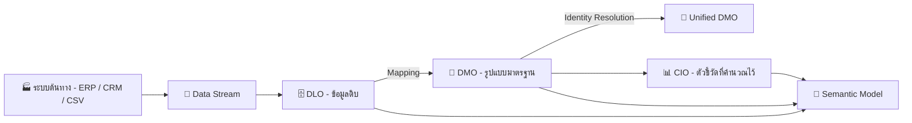
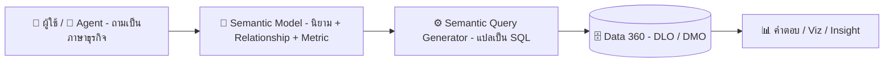

# 📘 Tableau Semantics คืออะไร และทำไมองค์กรยุค AI ต้องมี

> ทำความเข้าใจ **Tableau Semantics** ชั้นความหมายของข้อมูล (Semantic Layer) บน Salesforce Data 360 ตั้งแต่พื้นฐานอย่าง **DLO และ DMO** ไปจนถึงวิธีเริ่มสร้าง Semantic Model

🇹🇭 **ภาษาไทย** · 🇺🇸 [English version](README.en.md)

> [!IMPORTANT]
> **อัปเดตล่าสุด: 9 ตุลาคม 2026** ฟีเจอร์ของ Tableau Semantics และ Tableau Next เปลี่ยนแปลงเร็ว ชื่อเมนูและบางฟีเจอร์ (โดยเฉพาะที่เป็น Beta) อาจต่างไปตาม Release ควรตรวจสอบกับแหล่งอ้างอิงล่าสุดก่อนใช้งาน

> [!NOTE]
> **⚖️ ข้อจำกัดความรับผิดชอบ (Disclaimer)**
>
> เอกสารนี้จัดทำขึ้นจากการรวบรวมข้อมูลโดยส่วนตัวของผู้เขียน เพื่อวัตถุประสงค์ในการแบ่งปันความรู้เท่านั้น มิใช่เอกสารทางการของเจ้าของผลิตภัณฑ์ และไม่สามารถใช้เป็นเอกสารอ้างอิงทางการค้าได้ หากต้องการนำข้อมูลไปใช้อ้างอิง กรุณาตรวจสอบข้อมูลล่าสุดจากเว็บไซต์ทางการของเจ้าของผลิตภัณฑ์อีกครั้ง
>
> *This document is a personal compilation intended for knowledge-sharing purposes only. It is not official documentation from the product owner and shall not be used as a commercial reference. Please verify all information against the product owner's official website before use.*

---

## 🧭 สารบัญ

| | หัวข้อ |
|:---:|---|
| ⚡ | [สรุปใน 1 นาที](#-สรุปใน-1-นาที) |
| 1️⃣ | [Tableau Semantics คืออะไร](#1️⃣-tableau-semantics-คืออะไร) |
| 2️⃣ | [ปูพื้นฐาน: Data Stream, DLO, DMO และ CIO](#2️⃣-ปูพื้นฐาน-data-stream-dlo-dmo-และ-cio) |
| 3️⃣ | [ทำไมต้องมี](#3️⃣-ทำไมต้องมี) |
| 4️⃣ | [ที่มา](#4️⃣-ที่มา) |
| 5️⃣ | [ประโยชน์](#5️⃣-ประโยชน์) |
| 6️⃣ | [ข้อดี และ ข้อเสีย](#6️⃣-ข้อดี-และ-ข้อเสีย) |
| 7️⃣ | [สิ่งที่ต้องมี](#7️⃣-สิ่งที่ต้องมี) |
| 8️⃣ | [การทำงาน](#8️⃣-การทำงาน) |
| 9️⃣ | [การสร้าง Semantic Model](#9️⃣-การสร้าง-semantic-model) |
| 🔟 | [เทียบกับ Published Data Source และ Best Practices](#-เทียบกับ-published-data-source-และ-best-practices) |
| 🚀 | [Next Step](#-next-step) |
| 📖 | [อภิธานศัพท์](#-อภิธานศัพท์) |
| 🎓 | [แหล่งเรียนรู้เพิ่มเติม](#-แหล่งเรียนรู้เพิ่มเติม) |
| 📚 | [แหล่งอ้างอิง](#-แหล่งอ้างอิง) |

---

## ⚡ สรุปใน 1 นาที

| คำถาม | คำตอบสั้น ๆ |
|---|---|
| 📘 **คืออะไร** | ชั้นกลางที่แปล "ข้อมูลดิบ" ให้เป็น "ภาษาธุรกิจ" ที่คนและ AI เข้าใจตรงกัน |
| 🏠 **อยู่ที่ไหน** | บน **Data 360** (ชื่อเดิม Data Cloud) ของ Salesforce |
| 🎯 **แก้ปัญหาอะไร** | ตัวเลขแต่ละฝ่ายไม่ตรงกัน และ AI ตอบผิดเพราะไม่รู้นิยามธุรกิจ |
| 🧱 **หน่วยหลัก** | **Semantic Model** ที่รวมตาราง ความสัมพันธ์ สูตรคำนวณ และ Metric ไว้ด้วยกัน |
| 🗂️ **ใช้ข้อมูลจากไหน** | **DLO** (ข้อมูลที่นำเข้า) และ **DMO** (ข้อมูลที่จัดรูปแบบมาตรฐานแล้ว) ใน Data 360 |
| ⚖️ **ข้อแลกเปลี่ยน** | ต้องมี Data 360, มีค่าใช้จ่ายเพิ่ม และผูกกับ Salesforce Ecosystem |
| 🔑 **หัวใจความสำเร็จ** | นิยามที่คนในองค์กร **ตกลงร่วมกัน** สำคัญกว่าตัวเครื่องมือ |

---

## 1️⃣ Tableau Semantics คืออะไร

Tableau Semantics คือ **Semantic Layer** (ชั้นความหมายของข้อมูล) ของ Salesforce ที่อยู่บน **Data 360** ทำหน้าที่แปล "ข้อมูลดิบในตาราง" ให้เป็น "ภาษาธุรกิจ" ที่ทั้งคนและ AI เข้าใจตรงกัน

> [!TIP]
> 🗣️ **เปรียบง่าย ๆ:** Semantic Layer คือ **ล่ามประจำองค์กร** ฐานข้อมูลพูดว่า `SUM(amt_net) WHERE status = 'C'` ส่วนผู้บริหารพูดว่า "ยอดขายสุทธิ" ล่ามรู้ว่าทั้งสองคือเรื่องเดียวกัน และตอบทุกคนด้วยสูตรเดียวกันเสมอ

หน่วยหลักของ Tableau Semantics คือ **Semantic Model** เปรียบเหมือน "กล่อง" ที่รวมนิยามทางธุรกิจของ 1 เรื่อง (Use Case) ไว้ด้วยกัน

| องค์ประกอบ | ความหมาย | ตัวอย่าง |
|---|---|---|
| 🗂️ **Data Objects** | ตารางข้อมูลใน Data 360 ได้แก่ DLO, DMO และ CIO *(ดูหัวข้อ 2️⃣)* | Orders, Customers |
| 🔗 **Relationships** | ตารางเชื่อมกันด้วย Field อะไร | Orders ↔ Customers ด้วย Customer ID |
| 🧮 **Calculated Fields** | สูตรคำนวณเพิ่ม (Dimension / Measurement) | Profit Ratio |
| 📏 **Metrics** | ตัวชี้วัดที่มีมิติเวลาและนิยามกลาง | ยอดขายรายเดือน |
| 🏷️ **Business Metadata** | ชื่อที่อ่านง่าย คำอธิบาย คำพ้อง | `amt_net` → "ยอดขายสุทธิ" |

> [!NOTE]
> Semantic Model เป็น Metadata ของ Salesforce โดยตรง จึงใช้ซ้ำได้ทั้งใน Tableau Next, Agentforce, Tableau Cloud / Desktop และผ่าน API

📎 อ้างอิง: [Tableau Semantics (Product Page)](https://www.tableau.com/products/tableau-semantics) · [Tableau Semantics Concepts (Salesforce Developers)](https://developer.salesforce.com/docs/data/semantic-layer/guide/tableau-semantics-concepts.html)

---

## 2️⃣ ปูพื้นฐาน: Data Stream, DLO, DMO และ CIO

ก่อนสร้าง Semantic Model ต้องเข้าใจก่อนว่าข้อมูลใน Data 360 เดินทางผ่านอะไรบ้าง

### 📌 นิยาม

| คำ | ชื่อเต็ม | นิยามแบบเข้าใจง่าย |
|---|---|---|
| 🔌 **Data Stream** | Data Stream | **"ท่อส่งข้อมูล"** เก็บข้อมูลการเชื่อมต่อกับต้นทาง เช่น ต้นทางคืออะไร (S3, Google BigQuery ฯลฯ), ดึง Field อะไร, Primary Key และความถี่ในการ Refresh |
| 🗄️ **DLO** | Data Lake Object | **"ห้องเก็บข้อมูลดิบ"** ที่ข้อมูลถูกนำเข้ามาเก็บใน Data 360 (หรืออ้างอิงจากระบบภายนอก เช่น Snowflake) โครงสร้างยังเป็นแบบต้นทาง |
| 🧩 **DMO** | Data Model Object | **"ข้อมูลที่จัดรูปแบบมาตรฐานแล้ว"** กำหนดโครงสร้างกลางของข้อมูลจาก DLO หนึ่งหรือหลายตัว เช่น ทุกระบบใช้ชื่อ Field "Email" เหมือนกัน |
| 👤 **Unified DMO** | Unified Data Model Object | DMO ที่ **รวมข้อมูลของคนคนเดียวกันจากหลายระบบเป็นหนึ่งเดียว** ผ่านกฎ Identity Resolution |
| 📊 **CIO** | Calculated Insight Object | **"ตัวชี้วัดที่คำนวณไว้แล้ว"** เช่น Customer Lifetime Value, คะแนนความพึงพอใจลูกค้า (CSAT) |

### 🍳 เปรียบเทียบกับ "ครัวร้านอาหาร"

| ขั้น | ในครัว | ใน Data 360 |
|:---:|---|---|
| 1 | 🚚 รถส่งวัตถุดิบจากซัพพลายเออร์ | 🔌 **Data Stream** |
| 2 | 📦 ห้องเก็บวัตถุดิบตามที่ได้รับมา | 🗄️ **DLO** |
| 3 | 🔪 วัตถุดิบที่หั่น ล้าง จัดเป็นมาตรฐานเดียวกัน | 🧩 **DMO** |
| 4 | 🧂 ซอสหรือน้ำซุปที่ทำเตรียมไว้ล่วงหน้า | 📊 **CIO** |
| 5 | 📖 สูตรอาหารและเมนูที่ทุกคนในครัวใช้ตรงกัน | 📘 **Semantic Model** |
| 6 | 🍽️ อาหารที่เสิร์ฟให้ลูกค้า | 📊 Dashboard / คำตอบของ AI Agent |

### 🔄 ข้อมูลไหลอย่างไร

### ⚖️ DLO ต่างจาก DMO อย่างไร

| | 🗄️ DLO | 🧩 DMO |
|---|---|---|
| **โครงสร้าง** | ตามระบบต้นทาง | ตามโมเดลมาตรฐานกลาง (Customer 360 Data Model) |
| **ชื่อ Field** | ตามต้นทาง เช่น `cust_email`, `e_mail` | ชื่อกลางเหมือนกัน เช่น `Email` |
| **มาจาก** | Data Stream หรือไฟล์ที่อัปโหลด | Mapping จาก DLO หนึ่งหรือหลายตัว |
| **ใช้ทำอะไร** | เก็บและเตรียมข้อมูล | รวมข้อมูลหลายระบบให้ใช้ร่วมกันได้ |

### 🏢 ตัวอย่าง: บริษัทตัวอย่าง (Demo Company)

| ขั้น | สิ่งที่เกิดขึ้น |
|:---:|---|
| 1 | ระบบ POS และ E-commerce ส่งข้อมูลการขายเข้ามาผ่าน **Data Stream** คนละท่อ |
| 2 | ข้อมูลแต่ละระบบถูกเก็บใน **DLO** ของตัวเอง ชื่อ Field ไม่เหมือนกัน (`cust_email` กับ `e_mail`) |
| 3 | ทีม Data **Map** DLO ทั้งสองเข้า **DMO** "Sales Order" ที่ใช้ Field `Email` เหมือนกัน |
| 4 | **Identity Resolution** รวมลูกค้าคนเดียวกันจากทั้งสองระบบเป็น **Unified DMO** |
| 5 | **Semantic Model** นำ DMO มากำหนดนิยาม "ยอดขายสุทธิ" ให้ทุกฝ่ายและ AI ใช้ตรงกัน |

> [!TIP]
> ถ้าอัปโหลดไฟล์ **CSV** เข้า Workspace ใน Tableau Next ไฟล์นั้นจะถูกเก็บใน Data 360 เป็น **DLO** และนำไปใช้ใน Semantic Model ได้ทันที

📎 อ้างอิง: [Understanding Salesforce and Data Cloud Terms (Tableau Help)](https://help.tableau.com/current/tableau-next/en-us/tableau_next_sf_datacloud_terms.htm) · [Object Model in Data 360 (Salesforce Developers)](https://developer.salesforce.com/docs/data/data-cloud-dev/guide/dc-object-model.html)

---

## 3️⃣ ทำไมต้องมี

ปัญหาคลาสสิกที่ทุกองค์กรเจอคือ **"ตัวเลขไม่ตรงกัน"**

> [!NOTE]
> 🏢 **ตัวอย่าง:** ที่ **บริษัทตัวอย่าง (Demo Company)** ฝ่ายขายนับ "ยอดขาย" รวม VAT ฝ่ายบัญชีนับหลังหักส่วนลด ฝ่ายการตลาดนับเฉพาะออเดอร์ออนไลน์ ประชุมทีไรเสียเวลาครึ่งชั่วโมงแรกเถียงกันว่าตัวเลขใครถูก

ในยุค AI ปัญหานี้หนักขึ้น เพราะ AI Agent ไม่รู้บริบทธุรกิจ ถ้าถามว่า "ยอดขายไตรมาสนี้เท่าไร" โดยไม่มีนิยามกลาง Agent จะเดาเอง และ **ตอบผิดอย่างมั่นใจ**

> [!IMPORTANT]
> Semantic Layer คือ **"สมอง" ของ AI Agent ด้านข้อมูล** Agent จะตอบได้แม่นแค่ไหน ขึ้นกับคุณภาพของ Semantic Model ที่อยู่เบื้องหลัง

📎 อ้างอิง: [What is Tableau Semantics? (Tableau Blog)](https://www.tableau.com/blog/what-is-tableau-semantics)

---

## 4️⃣ ที่มา

| ยุค | พัฒนาการ |
|---|---|
| 📼 **ยุค 1990s** | BI รุ่นแรกเริ่มมีชั้นกลางแปลชื่อคอลัมน์เป็นคำธุรกิจ (เช่น แนวคิด "Universe") |
| 💻 **ยุค 2010s** | Self-service BI เติบโต แต่ละ Dashboard มีสูตรของตัวเอง นิยามซ้ำซ้อน จึงเกิดเครื่องมืออย่าง LookML และ Metrics Layer |
| 📊 **Tableau ยุคเดิม** | ใช้ Published Data Source และ Data Model (Relationships) เป็น Semantic Layer ระดับ Data Source |
| 🚀 **ปี 2024** | Salesforce เปิดตัวแพลตฟอร์ม Agentic Analytics (Tableau Einstein ต่อมาเปลี่ยนชื่อเป็น **Tableau Next**) พร้อม Tableau Semantics |
| ✅ **ปี 2025** | Tableau Semantics เปิดใช้งานจริง (GA) และ **14 ต.ค. 2025** Data Cloud เปลี่ยนชื่อเป็น **Data 360** |
| 🤖 **ปี 2026** | เพิ่มฟีเจอร์ AI เช่น การสร้าง Model อัตโนมัติ (บางตัวยังเป็น Beta) |

> [!TIP]
> **จุดเปลี่ยนสำคัญ:** นิยามธุรกิจถูกยกออกจาก "ไฟล์ Workbook / Data Source แต่ละไฟล์" ขึ้นไปอยู่ที่ **ระดับแพลตฟอร์ม** ให้ทุกแอปและทุก Agent ใช้ร่วมกัน

📎 อ้างอิง: [What is Tableau Semantics? (Tableau Blog)](https://www.tableau.com/blog/what-is-tableau-semantics) · [Understanding Salesforce and Data Cloud Terms (Tableau Help)](https://help.tableau.com/current/tableau-next/en-us/tableau_next_sf_datacloud_terms.htm) · [What you need to know about Tableau Next in 2026 (Hex)](https://hex.tech/blog/tableau-next/)

---

## 5️⃣ ประโยชน์

| | ประโยชน์ | รายละเอียด |
|:---:|---|---|
| 🎯 | **Single Source of Truth** | นิยาม Metric ครั้งเดียว ใช้ได้ทุกที่ ตัวเลขตรงกันทั้งองค์กร |
| 🤖 | **AI ตอบแม่นขึ้น** | Agentforce และ Tableau Agent เข้าใจคำถามภาษาธุรกิจเพราะมีบริบท |
| ⚡ | **สร้างเร็วขึ้น** | AI ช่วยแนะนำ Relationship และร่างสูตรคำนวณจากภาษาธรรมชาติ |
| 🛡️ | **Self-service ที่ปลอดภัย** | ผู้ใช้ธุรกิจสำรวจข้อมูลเองได้ ภายใต้นิยามที่ถูกกำกับดูแล |
| ♻️ | **ไม่ต้องทิ้งของเดิม** | นำเข้า Published Data Source ที่มีอยู่ได้ และเชื่อมต่อจาก Tableau Cloud, Server, Desktop มาใช้ Semantic Model ได้ |

📎 อ้างอิง: [Tableau Semantics (Salesforce)](https://www.salesforce.com/analytics/tableau-semantics/) · [Tableau Semantics (Product Page)](https://www.tableau.com/products/tableau-semantics)

---

## 6️⃣ ข้อดี และ ข้อเสีย

| ✅ ข้อดี | ⚠️ ข้อเสีย / ข้อจำกัด |
|---|---|
| นิยามกลาง ลดการเถียงเรื่องตัวเลข | **ต้องมี Data 360** ใช้แยกเดี่ยวไม่ได้ |
| ออกแบบมารองรับ AI Agent ตั้งแต่ต้น | มีค่าใช้จ่ายเพิ่ม มากับ Tableau+ และใช้ Data 360 Credits |
| ใช้ซ้ำได้ข้ามแอปใน Salesforce Ecosystem | ผูกกับ Ecosystem ของ Salesforce (Vendor Lock-in) |
| AI ช่วยสร้าง Model ลดงาน Manual | ฐานข้อมูลใหญ่ ตารางเยอะ ทำ Model ใช้แรงมาก |
| หน้าจอคล้าย Relationships ใน Tableau Desktop เรียนรู้ง่าย | ฟีเจอร์ใหม่หลายตัวยังเป็น Beta เปลี่ยนแปลงเร็ว |
| Governance และ Security สืบทอดจากแพลตฟอร์ม | ต้องมีเจ้าของนิยาม (Data Owner) ชัดเจน ไม่งั้น Model ไม่มีคุณภาพ |

> [!WARNING]
> **ความเข้าใจผิดที่พบบ่อย:** "มี Semantic Layer แล้วข้อมูลจะดีเอง" ความจริงคือ Semantic Layer **ไม่ได้แก้ข้อมูลสกปรก** ถ้าข้อมูลต้นทางผิด นิยามดีแค่ไหนก็ให้คำตอบผิด

📎 อ้างอิง: [Semantic Modelling in Tableau Next: The Pros and Cons (The Data School)](https://thedataschool.co.uk/sharon-orazulike/tableau-next-3/) · [Tableau Cloud Pricing](https://www.tableau.com/pricing/cloud)

---

## 7️⃣ สิ่งที่ต้องมี

### 🖥️ ด้านเทคนิค

| # | สิ่งที่ต้องมี |
|:---:|---|
| 1 | Salesforce Org ที่เปิดใช้ **Data 360** |
| 2 | License **Tableau+** (รวม Tableau Next และ Tableau Semantics) หรือ License Data 360 |
| 3 | ข้อมูลที่นำเข้าหรือเชื่อมต่อ (Federate) เข้า Data 360 แล้ว ในรูป **DLO / DMO** *(ดูหัวข้อ 2️⃣)* |
| 4 | สิทธิ์ผู้ใช้สำหรับสร้างและแก้ไข Semantic Model |

### 👥 ด้านคนและกระบวนการ *(สำคัญไม่แพ้กัน)*

| # | สิ่งที่ต้องมี |
|:---:|---|
| 1 | รายการ Metric หลักขององค์กร พร้อมนิยามที่ตกลงกันแล้ว |
| 2 | เจ้าของนิยามแต่ละตัว (เช่น ฝ่ายบัญชีเป็นเจ้าของ "รายได้") |
| 3 | Use Case ที่ชัดเจน เริ่มจากเรื่องเล็ก ๆ หนึ่งเรื่อง |

📎 อ้างอิง: [Tableau Semantics (Product Page)](https://www.tableau.com/products/tableau-semantics) · [Tableau Cloud Pricing](https://www.tableau.com/pricing/cloud)

---

## 8️⃣ การทำงาน

หัวใจของระบบคือ **Semantic Query Generator** ที่รับคำถามภาษาธุรกิจ แล้วแปลเป็น SQL ตามนิยามใน Semantic Model

| ขั้นตอน | สิ่งที่เกิดขึ้น |
|:---:|---|
| 1 | ผู้ใช้หรือ Agent ถาม เช่น "ยอดขายสุทธิแยกตามภูมิภาคเดือนนี้" |
| 2 | ระบบจับคู่คำว่า "ยอดขายสุทธิ" กับ Metric ที่นิยามไว้ใน Semantic Model |
| 3 | Semantic Query Generator สร้าง SQL จาก Relationship และสูตรกลาง |
| 4 | Query ถูกส่งไปประมวลผลที่ Data 360 |
| 5 | ผลลัพธ์กลับมาเป็น Visualization, Metric หรือคำตอบของ Agent |

📎 อ้างอิง: [Tableau Semantics Concepts (Salesforce Developers)](https://developer.salesforce.com/docs/data/semantic-layer/guide/tableau-semantics-concepts.html)

---

## 9️⃣ การสร้าง Semantic Model

ขั้นตอนโดยรวมใน Tableau Next *(ชื่อเมนูอาจต่างไปตาม Release)*

| ขั้นตอน | ทำอะไร |
|:---:|---|
| 1 | **เตรียมข้อมูล:** นำข้อมูลเข้า Data 360 และตรวจว่า DLO / DMO พร้อมใช้ |
| 2 | **เปิด Workspace:** ใน Tableau Next แล้วเพิ่ม Data Object ที่ต้องการ |
| 3 | **สร้าง Semantic Model ใหม่:** ตั้งชื่อและคำอธิบายให้สื่อถึง Use Case |
| 4 | **เพิ่ม Data Objects:** ลงใน Model Canvas |
| 5 | **กำหนด Relationships:** เลือก Field ที่ใช้เชื่อม หรือใช้คำแนะนำจาก AI แล้วกด Apply ทุกครั้ง |
| 6 | **ปรับชื่อและคำอธิบาย Field:** เป็นภาษาธุรกิจ และซ่อน Field ที่ไม่จำเป็น |
| 7 | **สร้าง Calculated Fields:** พิมพ์เป็นภาษาธรรมชาติให้ AI ช่วยร่างสูตรได้ |
| 8 | **สร้าง Metrics:** กำหนด Measure, มิติเวลา และ Dimension ที่ใช้เจาะลึก |
| 9 | **ทดสอบ:** ดึง Field จากหลายตารางมาดูว่าตัวเลขถูกต้อง |
| 10 | **นำไปใช้:** สร้าง Visualization, Dashboard หรือเปิดให้ Agent ใช้ แล้วแชร์ให้ทีม |

> [!TIP]
> ถ้ามี Tableau **Published Data Source** อยู่แล้ว ให้นำเข้ามาเป็นจุดเริ่มต้นแทนการสร้างใหม่ทั้งหมด ประหยัดเวลาและรักษาสูตรเดิมที่ทีมคุ้นเคย

### 🧩 เทคนิคที่ควรรู้

| เทคนิค | ใช้ทำอะไร |
|---|---|
| 🧩 **Logical View** | ทำ Join / Union ภายใน Model ได้ผลเป็นเหมือนตารางเดียว ที่นำไปสร้าง Relationship ต่อได้ |
| 🔗 **Relationship** | เชื่อมตารางที่ตัว Semantic Model โดยตรง ไม่ต้องใช้ Logical View |
| 🌱 **Extend Model** | สร้าง Model ใหม่ต่อยอดจาก Model กลาง โดยยังเชื่อมกับต้นฉบับ เหมาะให้แต่ละทีมขยายเอง |
| 🧪 **Test Model** | ดึง Field มาดูพฤติกรรมข้อมูลก่อนสร้าง Visualization |

📎 อ้างอิง: [Semantic Models in Tableau Next Quick Look (Trailhead)](https://trailhead.salesforce.com/content/learn/modules/semantic-models-in-tableau-next-quick-look/get-to-know-semantic-models) · [Tableau Next: Building a Semantic Model (The Data School)](https://www.thedataschool.co.uk/rosh-khan/tableau-next-building-a-semantic-model) · [Semantic Models and Logical Views (The Data School)](https://thedataschool.co.uk/olivia-grace-yuki-millar/semantic-models-in-tableau-next-2)

---

## 🔟 เทียบกับ Published Data Source และ Best Practices

| หัวข้อ | 📊 Published Data Source | 📘 Tableau Semantics |
|---|---|---|
| **อยู่ที่ไหน** | Tableau Cloud / Server | Data 360 (Salesforce Platform) |
| **ใช้ได้ที่ไหน** | ภายใน Tableau | Tableau Next, Agentforce, Tableau Cloud / Desktop, API |
| **ออกแบบมาเพื่อ** | นักวิเคราะห์สร้าง Viz | ทั้งคนและ AI Agent |
| **Metrics กลาง** | ผ่าน Tableau Pulse | เป็นส่วนหนึ่งของ Model |

### ✅ Best Practices

| | แนวปฏิบัติ |
|:---:|---|
| 🏷️ | ตั้งชื่อ Field เป็นคำที่ผู้ใช้พูดจริง และใส่คำอธิบายเสมอ เพราะ AI อ่านคำอธิบายนี้ |
| 🎯 | หนึ่ง Model ต่อหนึ่ง Use Case อย่าทำ Model เดียวครอบจักรวาล |
| 🔁 | ทบทวนนิยามกับเจ้าของธุรกิจเป็นรอบ ๆ |

> [!WARNING]
> เมื่อเชื่อมต่อจาก Tableau Desktop หรือ Tableau Cloud ผ่าน **Tableau Semantics Connector** ฟังก์ชันบางอย่างของ Tableau จะใช้ไม่ได้ เพราะถูกควบคุมจาก Semantic Model ควรทดสอบกับ Workbook จริงก่อนวางแผนย้ายงาน

📎 อ้างอิง: [Connect to Semantic Models (Trailhead)](https://trailhead.salesforce.com/content/learn/modules/data-management-across-tableau-products/connect-to-semantic-models) · [Understanding Salesforce and Data Cloud Terms (Tableau Help)](https://help.tableau.com/current/tableau-next/en-us/tableau_next_sf_datacloud_terms.htm)

---

## 🚀 Next Step

| ขั้นตอน | สิ่งที่ควรทำ |
|:---:|---|
| 1 | รวบรวม Metric สำคัญ 5–10 ตัว และตกลงนิยามกับเจ้าของธุรกิจ |
| 2 | ตรวจสอบ License ปัจจุบันว่าครอบคลุม Tableau+ / Data 360 หรือยัง |
| 3 | เลือก Use Case นำร่องหนึ่งเรื่อง (เช่น Sales Performance) |
| 4 | สำรวจข้อมูลใน Data 360 ว่ามี DLO / DMO ที่ต้องใช้ครบหรือยัง |
| 5 | สร้าง Semantic Model แรก หรือนำเข้า Published Data Source ที่มีอยู่ |
| 6 | ทดสอบถามผ่าน Agent แล้วปรับคำอธิบาย Field จนตอบได้แม่น |
| 7 | ขยายไป Use Case ถัดไป และวางกระบวนการ Governance |

---

## 📖 อภิธานศัพท์

| คำศัพท์ | ความหมาย |
|---|---|
| **Semantic Layer** | ชั้นกลางที่แปลข้อมูลดิบเป็นภาษาธุรกิจ |
| **Semantic Model** | หน่วยหลักของ Tableau Semantics รวมข้อมูล ความสัมพันธ์ สูตร และ Metric ของ 1 Use Case |
| **Data 360** | แพลตฟอร์มข้อมูลของ Salesforce (ชื่อเดิม Data Cloud เปลี่ยนชื่อเมื่อ 14 ต.ค. 2025) |
| **Data Stream** | ข้อมูลการเชื่อมต่อกับระบบต้นทาง และความถี่ในการดึงข้อมูล |
| **DLO** | Data Lake Object ที่เก็บข้อมูลที่นำเข้า Data 360 ตามโครงสร้างต้นทาง |
| **DMO** | Data Model Object โครงสร้างข้อมูลมาตรฐานที่ Map มาจาก DLO |
| **Unified DMO** | DMO ที่รวมข้อมูลของคนเดียวกันจากหลายระบบด้วย Identity Resolution |
| **CIO** | Calculated Insight Object ตัวชี้วัดที่คำนวณและเก็บไว้ใน Data 360 |
| **Identity Resolution** | กฎสำหรับจับคู่และรวมข้อมูลที่เป็นคนหรือสิ่งเดียวกันจากหลายแหล่ง |
| **Published Data Source (PDS)** | Data Source ที่ Publish ไว้บน Tableau Cloud / Server ให้หลาย Workbook ใช้ร่วมกัน |
| **Tableau Next** | แพลตฟอร์ม Agentic Analytics ของ Tableau บน Salesforce |
| **Agentforce** | แพลตฟอร์ม AI Agent ของ Salesforce |

📎 อ้างอิง: [Understanding Salesforce and Data Cloud Terms (Tableau Help)](https://help.tableau.com/current/tableau-next/en-us/tableau_next_sf_datacloud_terms.htm) · [Object Model in Data 360 (Salesforce Developers)](https://developer.salesforce.com/docs/data/data-cloud-dev/guide/dc-object-model.html)

---

## 🎓 แหล่งเรียนรู้เพิ่มเติม

| ประเภท | แหล่ง | เหมาะกับ |
|---|---|---|
| 🎥 YouTube | [Tableau Tim: Tableau Next Playlist](https://youtu.be/Rp5lw1EYmPM) | ดู Demo ทีละขั้น |
| 🎥 YouTube | ช่องทางการ Tableau และ Salesforce Developers | ฟีเจอร์ใหม่และ Session งาน Conference |
| 🏔️ Trailhead | [Semantic Models in Tableau Next Quick Look](https://trailhead.salesforce.com/content/learn/modules/semantic-models-in-tableau-next-quick-look/get-to-know-semantic-models) | ผู้เริ่มต้น |
| 🏔️ Trailhead | [Connect to Semantic Models](https://trailhead.salesforce.com/content/learn/modules/data-management-across-tableau-products/connect-to-semantic-models) | ผู้ใช้ Tableau Desktop / Cloud |
| 🎬 Course | [The Information Lab: Getting Started with Tableau Next](https://www.theinformationlab.co.uk/services/training/on-demand/getting-started-with-tableau-next/creating-a-semantic-model-65c0/) | คอร์ส On-demand หลายตอน |
| 📝 Blog | [The Data School: Building a Semantic Model](https://www.thedataschool.co.uk/rosh-khan/tableau-next-building-a-semantic-model) | ลงมือทำพร้อม Screenshot |
| 📝 Blog | [The Data School: Semantic Models and Logical Views](https://thedataschool.co.uk/olivia-grace-yuki-millar/semantic-models-in-tableau-next-2) | Logical View |
| 📝 Blog | [The Data School: Join, Union, Relationship](https://thedataschool.co.uk/tomo-mensendiek/tableau-next-4/) | การรวมตาราง |

---

## 📚 แหล่งอ้างอิง

ตรวจสอบเมื่อ **9 ตุลาคม 2026**

| แหล่ง | เนื้อหา |
|---|---|
| [Tableau Semantics (Product Page)](https://www.tableau.com/products/tableau-semantics) | ภาพรวมผลิตภัณฑ์ |
| [What is Tableau Semantics? (Tableau Blog)](https://www.tableau.com/blog/what-is-tableau-semantics) | แนวคิดและความสำคัญ |
| [Tableau Semantics Concepts (Salesforce Developers)](https://developer.salesforce.com/docs/data/semantic-layer/guide/tableau-semantics-concepts.html) | องค์ประกอบและการทำงาน |
| [Understanding Salesforce and Data Cloud Terms (Tableau Help)](https://help.tableau.com/current/tableau-next/en-us/tableau_next_sf_datacloud_terms.htm) | นิยาม Data Stream, DLO, DMO, CIO และการเปลี่ยนชื่อเป็น Data 360 |
| [Object Model in Data 360 (Salesforce Developers)](https://developer.salesforce.com/docs/data/data-cloud-dev/guide/dc-object-model.html) | โครงสร้าง Object และการ Map จาก DLO ไป DMO |
| [Tableau Semantics (Salesforce)](https://www.salesforce.com/analytics/tableau-semantics/) | ประโยชน์และ Use Case |
| [Tableau Cloud Pricing](https://www.tableau.com/pricing/cloud) | Edition ที่มี Tableau Semantics |
| [Semantic Modelling in Tableau Next: The Pros and Cons (The Data School)](https://thedataschool.co.uk/sharon-orazulike/tableau-next-3/) | ข้อดีและข้อจำกัด |
| [What you need to know about Tableau Next in 2026 (Hex)](https://hex.tech/blog/tableau-next/) | พัฒนาการของ Tableau Next |

---

[⬆️ กลับไปด้านบน](#-tableau-semantics-คืออะไร-และทำไมองค์กรยุค-ai-ต้องมี) · 🇺🇸 [English version](README.en.md)

> [!NOTE]
> **⚖️ ข้อจำกัดความรับผิดชอบ (Disclaimer)**
>
> เอกสารนี้จัดทำขึ้นจากการรวบรวมข้อมูลโดยส่วนตัวของผู้เขียน เพื่อวัตถุประสงค์ในการแบ่งปันความรู้เท่านั้น มิใช่เอกสารทางการของเจ้าของผลิตภัณฑ์ และไม่สามารถใช้เป็นเอกสารอ้างอิงทางการค้าได้ หากต้องการนำข้อมูลไปใช้อ้างอิง กรุณาตรวจสอบข้อมูลล่าสุดจากเว็บไซต์ทางการของเจ้าของผลิตภัณฑ์อีกครั้ง
>
> *This document is a personal compilation intended for knowledge-sharing purposes only. It is not official documentation from the product owner and shall not be used as a commercial reference. Please verify all information against the product owner's official website before use.*

**Created by The Narit Lab**
